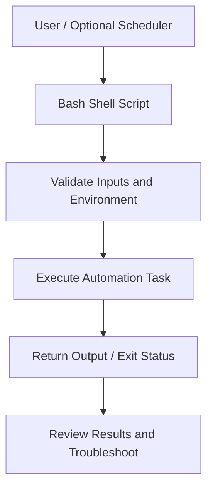

# Shell Script Automation

### Linux | Bash | Shell Scripting | Task Automation

A collection of shell scripts designed to automate repetitive tasks, simplify daily Linux administration, and improve operational efficiency.

This repository serves as a practical DevOps portfolio project, demonstrating scripting, task automation, troubleshooting, and Linux system administration.

---

## 📌 Project Purpose

The purpose of this repository is to organize reusable shell scripts that automate routine tasks in a Linux environment.

The goal is to reduce manual intervention, improve consistency, and strengthen practical automation skills relevant to DevOps and cloud engineering.

### Objectives

- Automate repetitive administrative tasks.
- Reduce manual errors through consistent execution.
- Improve efficiency when working with Linux systems.
- Build reusable, maintainable shell scripts.
- Practice troubleshooting and debugging.
- Develop scripting skills applicable to real-world DevOps environments.

---

## 🏗️ Architecture

The scripts follow a simple automation workflow in which a user or configured scheduler initiates a shell script that performs a defined task.



### Workflow Explanation

1. **Trigger:** A user manually executes a script, or a scheduler triggers it if scheduling has been configured.
2. **Validation:** The script checks necessary inputs, permissions, or dependencies where implemented.
3. **Execution:** Bash commands perform the specified automation task.
4. **Output:** The script displays results, writes output files, or returns an exit status.
5. **Troubleshooting:** Errors can be investigated using command output, exit codes, and available logs.

*Note: Scheduling, validation, and logging depend on the individual script and should not be assumed to be implemented across the repository.*

---

## 🛠️ Technologies and Tools

| Technology | Purpose |
|---|---|
| Linux | Operating environment for executing automation scripts |
| Bash / Shell | Scripting language used to automate command-line tasks |
| Git | Version control and tracking script changes |
| GitHub | Repository hosting, documentation, and portfolio presentation |
| Linux CLI Utilities | Perform filesystem, process, and system operations as needed |

### Optional Tools

The following may be incorporated in future automation projects:

- **Cron:** Schedule recurring tasks.
- **ShellCheck:** Perform static analysis of shell scripts.
- **Docker:** Test scripts in isolated environments.
- **GitHub Actions:** Automate syntax checks and testing.
- **AWS CLI:** Automate cloud-related operations when needed.

These optional tools are not represented as current implementations.

---

## ⚙️ Implementation

This repository is used to develop, maintain, and organize shell scripts for routine automation tasks.

### Personal Contributions

- Writing and modifying shell scripts for daily automation.
- Organizing scripts in a GitHub repository.
- Using Linux commands and Bash syntax to automate repetitive operations.
- Maintaining script versions with Git.
- Documenting script behavior and execution instructions.
- Investigating errors and updating scripts as necessary.

### Script Inventory

| Script | Description | Execution |
|---|---|---|
| `[script-name.sh]` | [Describe the task automated by this script] | Manual |
| `[another-script.sh]` | [Describe its purpose] | [Manual or scheduled] |

Each script should have a clearly defined purpose, documented inputs, and expected output.

---

## 🚀 How to Run

### Prerequisites

- Linux environment with Bash installed.
- Git installed to clone the repository.
- Required command-line utilities for the selected script.
- Appropriate permissions for the task.

### 1. Clone the Repository

```bash
git clone https://github.com/YOUR-USERNAME/YOUR-REPOSITORY.git
```

### 2. Navigate to the Repository

```bash
cd YOUR-REPOSITORY
```

### 3. Review the Script

Before running a script, examine its contents:

```bash
cat script-name.sh
```

Check for required dependencies, filesystem paths, and commands that may change or delete data.

### 4. Validate Bash Syntax

```bash
bash -n script-name.sh
```

A successful syntax check returns no output and an exit code of zero.

### 5. Execute the Script

```bash
bash script-name.sh
```

Run scripts using a standard user account whenever possible. Avoid `sudo` unless administrative privileges are necessary.

### 6. Verify Results

Check the script's output and verify that the intended task completed successfully.

For immediate exit-status inspection:

```bash
echo $?
```

### 7. Teardown / Cleanup

Cleanup depends on what a script creates or modifies.

- Remove temporary test files only after verifying they are no longer needed.
- Stop any test processes or scheduled jobs created specifically for testing.
- Do not delete production data or system files.
- Verify the environment has returned to its expected state.

This repository does not require cloud resources by default.

---

## 🔍 Troubleshooting

Troubleshooting is an important component of developing reliable automation.

### Troubleshooting Case Study Template

**Issue:** [Describe a real issue encountered when running one of your scripts.]

**Investigation:**

1. Reproduced the error.
2. Reviewed the terminal output and exit status.
3. Examined the relevant Bash commands.
4. Checked file paths, permissions, variables, or dependencies.
5. Tested a correction.

**Evidence:**

```text
[Insert the actual error message or relevant command output.]
```

**Root Cause:**

[Explain what caused the error based on the evidence.]

**Resolution:**

[Describe the changes made to the script or environment.]

**Verification:**

[Explain how you confirmed the script worked after the fix.]

**Lessons Learned:**

[Explain how this issue improved your understanding of Bash, Linux, or automation.]

*Replace this template with an actual troubleshooting experience. Do not describe a hypothetical problem as one you personally resolved.*

---

## 🔐 Security and Cost Considerations

### Security Best Practices

- Never commit passwords, access keys, tokens, or private credentials to GitHub.
- Use environment variables or approved secret-management services when authentication is necessary.
- Follow the principle of least privilege.
- Run scripts using non-administrative accounts whenever practical.
- Validate user inputs and review commands that modify or delete files.
- Avoid exposing sensitive information in script output or logs.
- Add local secret files and sensitive configuration files to `.gitignore`.

### IAM Permissions

AWS IAM is not required for local-only shell scripts.

For future AWS automation, use IAM roles or appropriately scoped permissions rather than broadly granting administrator access.

### Cost Management

Local shell scripts generally do not require paid cloud infrastructure.

If scripts later interact with AWS or other cloud platforms:

- Set budget alerts before creating resources.
- Use cost-conscious resources for testing.
- Terminate temporary compute instances after testing.
- Delete unused storage, load balancers, and other billable resources.
- Verify resource cleanup using the cloud provider's management console or CLI.

---

## 📈 Future Improvements

Planned enhancements may include:

- [ ] Add structured error handling to scripts where needed.
- [ ] Implement reusable logging functions.
- [ ] Add Cron scheduling for suitable recurring tasks.
- [ ] Use ShellCheck for static analysis.
- [ ] Standardize script naming and documentation.
- [ ] Add input validation and safer defaults.
- [ ] Create automated tests for critical scripts.
- [ ] Integrate GitHub Actions for syntax checking.
- [ ] Explore AWS CLI automation for cloud administration tasks.

These improvements are goals and are not claimed as completed functionality.

---

## 📚 Learning Resources and Attribution

This repository supports continued learning in Linux administration, Bash scripting, automation, and DevOps engineering.

Relevant learning resources include:

- **TechWorld with Nana — DevOps Bootcamp:** Background learning in Linux, automation, cloud infrastructure, and DevOps workflows.
- **GNU Bash Documentation:** Reference for Bash syntax and scripting behavior.
- **Linux Manual Pages:** Documentation for Linux command-line utilities.
- **Git Documentation:** Reference for version control workflows.

Scripts developed from tutorials or guided exercises should identify the relevant source and distinguish guided instructions from independent modifications.

---

## 🎯 Skills Demonstrated

This repository is intended to demonstrate:

- Linux command-line proficiency
- Bash and shell scripting
- Task automation
- Git and GitHub version control
- Technical documentation
- Troubleshooting and debugging
- Security-conscious scripting
- DevOps fundamentals

---

## 👤 Author

**Wendell Bennett**

Aspiring DevOps / Cloud Engineer

Focused on strengthening hands-on skills in Linux, AWS, Docker, Kubernetes, Terraform, Jenkins, Ansible, Python, and automation.

This repository is part of my ongoing effort to develop practical, documented DevOps projects and build a professional technical portfolio.
